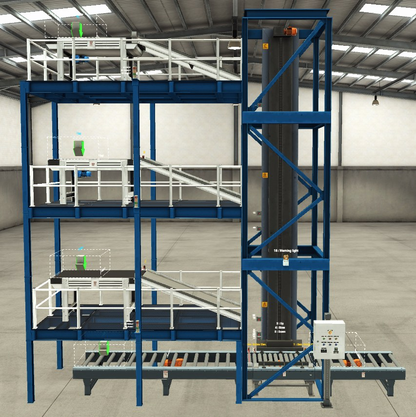
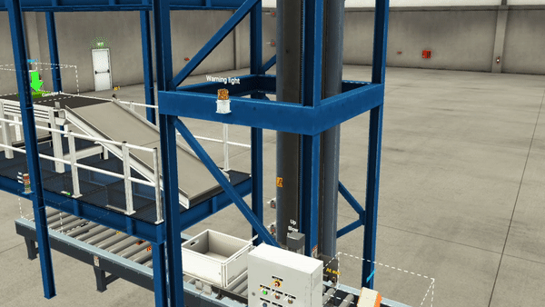

# Elevator (Advanced) in TIA Portal

A Siemens S7-1200 program for the Factory I/O scene Elevator (Advanced). A box rides the elevator up and down a shaft with four levels, plates are pushed out of the levels and fall into the box, and the full box leaves on the outfeed belt.

## Screenshots





## What the scene is

Factory I/O ships this scene with the objective "collect up to five items into a stackable box using an elevator". Empty boxes arrive on the infeed belt at level 0. Three levels above the ground floor each hold plates, and each level can release more than one, so a single cycle picks up five plates in total. When the box is full the elevator comes back to level 0 and the box is carried out on the outfeed belt.

Every level has two position sensors, a low one and a high one. They are used by direction. Going up the elevator slows down on the low sensor and stops on the high sensor. Going down it slows down on the high sensor and stops on the low sensor. That way it always lands level with the ramp of the floor it is visiting, whichever way it came.

## How the cycle runs

The program is one function block with a step counter, and each step does one thing.

1. Level 0. The infeed belt and the elevator belt run until the box is on the elevator and has cleared the entry sensor.
2. The elevator travels to level 1. Up and down are driven by the difference between the level it is on and the level it wants.
3. The belt of that level runs until the plate sensor has seen a plate, then for two more seconds so the plate leaves the belt and falls into the box.
4. Steps 2 and 3 repeat for the next level of the schedule.
5. After the fifth plate the elevator goes back to level 0.
6. The elevator belt and the outfeed belt run until the box has passed the exit sensor.
7. In automatic mode the next box is loaded at once. In manual mode the cycle waits for another press of Start.

The schedule is the list of levels the elevator visits, and it is a constant in the block:

```
Schedule : ARRAY[1..5] OF INT := 1, 2, 3, 2, 1;
```

Five plates are released, three on the way up and two on the way down. Change that list if your copy of the scene releases a different number, but keep the same number of entries and the same count in the loop guard.

Two timeouts protect the cycle. If no box reaches the elevator within fifteen seconds the block drops out with a fault, and if the plate sensor of a level stays quiet for ten seconds while its belt runs it also faults. A fault stops the cycle, lights the warning lamp and needs Reset. The travel step has a thirty second watchdog as well.

Stop ends the cycle that is running and holds the next one. Reset clears the fault and faults the elevator back to level 0 with no load. Emergency stop drops every output at once.

## The Ladder document

`LADDER.pdf` is the printable version of the program, in English. It has a title page, the tag table, and then the thirteen networks drawn as Ladder: the call of the block, the outputs released at the top of the scan, the panel buttons, the six timers, one network per step, the travel watchdog and the panel lamps. Contacts, coils, set and reset coils, timer boxes and instruction boxes are drawn the way TIA Portal prints them, and each network carries the same title and comment as the block.

`plc/LADDER_networks.md` is the same document as text, with the OB1 pin to tag mapping, in case you would rather build the networks by hand than import the source file.

## Panel

The panel in the scene has four buttons and a selector.

Start begins a cycle. Stop lets the current cycle finish and blocks the next one. Reset returns the elevator to level 0 and clears a fault. Emergency stop releases every actuator. The selector chooses automatic, where cycles follow each other, or manual, where one press of Start gives one cycle.

The three blue lamps show which level the elevator is at, and the four lamps next to the buttons follow Start, Stop, Reset and the warning state.

## I/O

These addresses are the ones the original project used for this scene in the Factory I/O driver configuration, so a copy of the scene set up that way works without changes. The names in the last column are the Factory I/O tag names the scene carries, kept here in their original spelling.

| Address | PLC tag | Direction | Factory I/O tag |
| :-- | :-- | :-- | :-- |
| %I0.6 | AtLow0 | Input | At 0 (low) |
| %I0.7 | AtHigh0 | Input | At 0 (high) |
| %I1.0 | AtLow1 | Input | At 1 (low) |
| %I1.1 | AtHigh1 | Input | At 1 (high) |
| %I1.2 | AtLow2 | Input | At 2 (low) |
| %I1.3 | AtHigh2 | Input | At 2 (high) |
| %I1.4 | AtLow3 | Input | At 3 (low) |
| %I1.5 | AtHigh3 | Input | At 3 (high) |
| %I1.6 | Start | Input | Start |
| %I1.7 | Reset | Input | Reset |
| %I2.0 | Stop | Input | Stop |
| %I2.1 | EStop | Input | Emergency stop |
| %I2.2 | AutoMode | Input | Auto |
| %I2.4 | BoxAtEntry | Input | Sen. Entrada Elev. |
| %I2.5 | BoxOnElevator | Input | Sen. Sobre Elev. |
| %I2.6 | BoxAtExit | Input | Sen. Saida Elev. |
| %I2.7 | PlateSeen1 | Input | Sen. Placa 1 |
| %I3.0 | PlateSeen2 | Input | Sen. Placa 2 |
| %I3.1 | PlateSeen3 | Input | Sen. Placa 3 |
| %Q0.0 | Belt0 | Output | Esteira 0 |
| %Q0.1 | Belt1 | Output | Esteira 1 |
| %Q0.2 | Belt2 | Output | Esteira 2 |
| %Q0.3 | Belt3 | Output | Esteira 3 |
| %Q0.4 | BeltExit | Output | Esteira saida |
| %Q0.5 | BeltElevator | Output | Esteira elevador |
| %Q0.7 | Up | Output | Subir |
| %Q1.0 | Down | Output | Descer |
| %Q1.1 | Slow | Output | Devagar |
| %Q1.2 | LampWarning | Output | Warning light |
| %Q1.3 | LampStart | Output | Start light |
| %Q1.4 | LampReset | Output | Reset light |
| %Q1.5 | LampStop | Output | Stop light |
| %Q1.6 | LampFloor1 | Output | Andar 1 |
| %Q1.7 | LampFloor2 | Output | Andar 2 |
| %Q2.0 | LampFloor3 | Output | Andar 3 |

The same list is in `plc/elevator_tags.csv`, in the layout TIA Portal expects when you import a tag table.

## Files

```
README.md
ATTRIBUTION.md
LADDER.pdf
plc/FB_ElevatorCycle.scl
plc/elevator_tags.csv
plc/LADDER_networks.md
tia/FactoryIOElevatorAdvancedV15
tia/FactoryIOElevatorAdvancedV15_V16
elevator-scene.jpg
demo.gif
```

`plc/FB_ElevatorCycle.scl` is an external source file. Add it in TIA Portal under External source files, then generate the block from it. The block needs one instance data block and one call in OB1. `plc/LADDER_networks.md` gives that call as a Ladder network and walks through the rest of the block network by network if you would rather build it by hand.

`tia/` holds the project this work started from, exactly as it was published: the same program saved twice, once by TIA Portal V15.1 and once opened and saved by V16. Open the `.ap15_1` or the `.ap16` file inside either folder with File, Open project, and TIA Portal loads it with its own Ladder, data blocks and tag table. That copy is ready to download to PLCSIM and run against the scene with nothing imported. The English block in `plc/` is the rewrite, it is not wired into those archives.

`LADDER.pdf` is the printable English document described above, and `demo.gif` is the scene running.

## Running it

1. Open Factory I/O and load the scene Elevator (Advanced) from the Scenes menu.
2. In Drivers pick Siemens S7-1200 and set the input and output ranges to the addresses in the table above, nineteen digital inputs and sixteen digital outputs.
3. In TIA Portal import `plc/elevator_tags.csv` as a tag table and add `plc/FB_ElevatorCycle.scl` as an external source file.
4. Build the block, call it once in OB1 with the mapping from `LADDER_networks.md`, and download to PLCSIM or a real CPU.
5. Put the selector in automatic, press Start, then switch to Factory I/O and watch the cycle.

The original project pulled in the MHJ-PLC-Lab communication block to reach the simulator. With the built-in S7-1200 driver and PLCSIM you do not need it.

If you only want to see the scene run, skip the import entirely and open `tia/FactoryIOElevatorAdvancedV15_V16/FactoryIOElevatorAdvancedV15_V16.ap16` from the tia folder. That project is complete, and the animation at the top of this page was recorded from it.

The scene itself comes with Factory I/O, so there is nothing to download besides this project.
